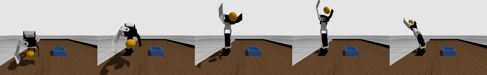

# crane-plus-throw

CRANE+ V2 がカメラでボールを見つけてつかみ、離れた箱へ投げ入れる ROS 2 + Gazebo のシミュレーションです。
Physical AI 応用1講座の最終課題として作りました。

- **見る**: 俯瞰カメラの画像を YOLOv8n で推論してボールを検出し、色で箱を検出する
- **学ぶ**: ロボット自身の試し投げ40回のデータから、「振る速さ → 着地距離」を MLP で学習する
- **投げる**: 箱までの距離からモデルを逆算して振る速さを決め、手首のスナップを効かせて真上で離す（関節速度は実機と同じ上限 2.0rad/s のまま）

ランダムな位置に置いた箱（内寸8cm角）への投げ入れで、10回中10回成功しました。

- 動画: https://youtu.be/knTTkEDmxwo
- 説明資料: [docs/report.md](docs/report.md)



## 動作環境

書籍『ROS 2とPythonで作って学ぶAIロボット入門 改訂第2版』の Docker イメージ
`airobotbook/ros2-desktop-ai-robot-book-humble` で動作を確認しました。

- ROS 2 Humble、Ignition Gazebo Fortress
- 書籍のワークスペース `~/airobot_ws`（CRANE+ V2 のモデルと `crane_plus_commander` を使います。このリポジトリには含みません）
- ultralytics（YOLOv8）、PyTorch、OpenCV（イメージに入っています）

## ビルド

```bash
mkdir -p ~/throw_ws && cd ~/throw_ws
git clone https://github.com/ryuu52465-lang/crane-plus-throw.git .
source /opt/ros/humble/setup.bash
source ~/airobot_ws/install/setup.bash
colcon build --symlink-install
source install/setup.bash
```

## 実行

```bash
# 1. シミュレーションを起動する（Gazebo、コントローラ、ブリッジ）
bash tools/restart_sim.sh

# 2. AIで狙って投げる（1回）
ros2 run crane_plus_throw ai_throw_node

# 箱とボールをランダムに置いて10回試し、成功率を出す
ros2 run crane_plus_throw ai_throw_node --ros-args -p evaluate:=true -p episodes:=10

# 箱を正面の17cm・21cm・25cmに置いて順に投げる（動画用）
ros2 run crane_plus_throw ai_throw_node --ros-args -p demo_distances:=[0.17,0.21,0.25]
```

`ai_throw_node` は学習済みモデルを `~/throw_ws/data/throw_model.pt` から読みます。
AIの判断画面は `/ai_throw/debug_image` に出ます。

### 学習をやり直す場合

```bash
# 振る速さ 0.8〜2.0rad/s でランダムに40回投げ、着地点を記録する
ros2 run crane_plus_throw collect_data ~/throw_ws/data/throw_data.csv 40 0.8 2.0
# MLPを学習する（モデルとグラフを保存）
cd ~/throw_ws/data && ros2 run crane_plus_throw train_model throw_data.csv throw_model.pt throw_model.png
```

## ファイル構成

```
src/crane_plus_throw/
  crane_plus_throw/
    throw_node.py      # つかむ・投げるの部品（可動範囲内の逆運動学、スナップ投げの軌道、離すタイミング）
    collect_data.py    # 試し投げの自動収集（ボールの勢いを止めて戻す、着地点の判定）
    throw_model.py     # MLP「振る速さ → 着地距離」と、距離からの逆算
    train_model.py     # 学習とグラフの出力
    ai_throw_node.py   # YOLO＋色検出 → モデルで速さを決める → 投げる。評価・動画撮影モード
  launch/throw_sim.launch.py   # Gazebo＋コントローラ＋ros_gz_bridge
  urdf/                        # 書籍の CRANE+ V2 に、ボールの固定・解放（DetachableJoint）を追加
  worlds/throw_world.sdf       # 机、ボール、箱、俯瞰カメラ、柵
data/        # 試投データ、学習済みモデル、評価結果
docs/        # 説明資料、作業記録、図
tools/       # 起動・実験・動画編集の補助スクリプト
```

## 謝辞

ロボットモデル、机のワールド、逆運動学は、書籍『ROS 2とPythonで作って学ぶAIロボット入門 改訂第2版』のサンプルをもとにしています。
物体検出には ultralytics の YOLOv8n（COCO で学習済みのモデル）を使っています。
