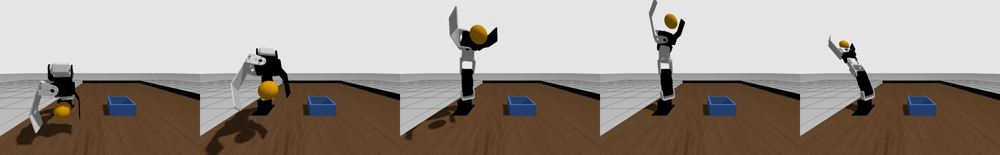
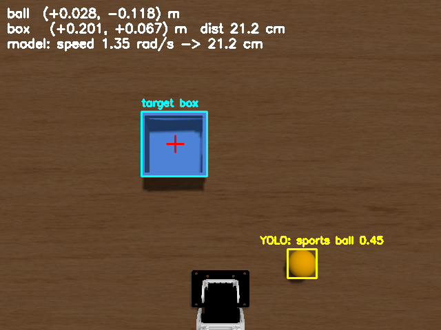
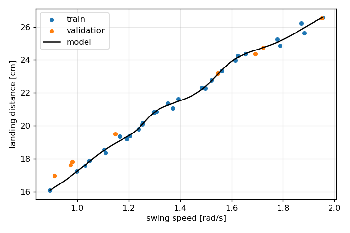

# CRANE+ V2 が「見て・学んで・投げ入れる」— 手首スナップ投げと試投データ学習による箱への投げ入れ

Physical AI 応用1講座 最終課題 説明資料

- 動画: （YouTubeのURL）※等速再生（倍速なし）
- コード: https://github.com/ryuu52465-lang/crane-plus-throw

---

## 1. 概要

小型ロボットアーム **CRANE+ V2** が、机の上のボールをカメラで見つけてつかみ、離れた場所にある箱へ**投げ入れる**タスクを、ROS 2 と Gazebo のシミュレーションで実現した。


*図1 スナップ投げ（左から: 持ち上げ → 振りかぶり → 手首を残して振り出す → 真上で離す → 振り抜き）*

AI は次の2か所で使っている。

| | 役割 | 方法 |
|---|---|---|
| **(A) 見る** | ボールの位置を知る | 俯瞰カメラの画像を **YOLOv8n**（学習済み）で推論し、「sports ball」を検出。画像座標を机の上の座標に変換する |
| **(B) 学ぶ** | 箱まで届く投げ方を決める | ロボット自身が40回試し投げしたデータから、「振る速さ → 着地距離」を **多層パーセプトロン（MLP）** で学習。箱までの距離からモデルを逆にたどって振る速さを決める |

結果として、箱（内寸8cm角）を毎回ランダムな位置に置いて試した10回すべてで、ボールが箱に入った。

## 2. 目的

- **ロボットに「投げる」という動的な動作をさせる。** 講座で扱った「つかんで置く」より一歩進めて、手の届かない場所へ物を届ける
- **実機と同じ制約のまま実現する。** CRANE+ V2 の関節速度の上限 2.0rad/s（実機のサーボの仕様）は変えない。シミュレーションでだけ成り立つ投げ方にはしない
- **ロボットが自分で試して学ぶ（Physical AI）。** 投げたボールの飛び方を物理の式で手計算するのではなく、ロボット自身の試投データから狙い方を学ぶ。考え方は、Google の TossingBot（試し投げから投げ方を学ぶロボット）を参考にした

## 3. システム構成

### 3.1 環境

| 項目 | 内容 |
|---|---|
| OS／実行環境 | Windows 11 上の Docker（書籍『ROS 2とPythonで作って学ぶAIロボット入門 改訂第2版』の公式イメージ） |
| ミドルウェア | ROS 2 Humble、Ignition Gazebo Fortress |
| ロボット | CRANE+ V2（4軸＋グリッパー）。書籍のGazeboモデルを使用 |
| AI | ultralytics YOLOv8n（推論のみ）、PyTorch（MLPの学習と推論）。いずれもCPUで動作 |

### 3.2 ワールド

書籍の机のワールドをもとに、次のものを追加した。

- オレンジ色のボール（直径4cm、20g）
- 青い箱（内寸8cm角、高さ4cm）。これが的
- 机の真上60cmから見下ろす俯瞰カメラ（640×480）
- ボールが机から落ちないようにする低い柵（前と左右）

### 3.3 処理の流れ

```
俯瞰カメラ画像
   │
   ├─ YOLOv8n ──→ ボールの位置 (x, y)
   └─ 色検出 ───→ 箱の位置 (x, y) → 距離 d・方向 θ
                                  │
                       学習したMLPを逆算 → 振る速さ v
                                  │
   つかむ（逆運動学） → 方向 θ へ旋回 → スナップ投げ（速さ v）→ 真上で離す
```

### 3.4 自作したノード

| ノード | 役割 |
|---|---|
| `throw_node` | つかむ・投げるの部品（逆運動学、スナップ投げの軌道、離すタイミングの制御） |
| `collect_data` | 試し投げを自動で繰り返し、振る速さと着地点を記録する |
| `train_model` | 記録したデータで MLP を学習する |
| `ai_throw_node` | 見る → 狙いを決める → つかむ → 投げる を行う。成功率の評価と動画の撮影もする |

## 4. 実装

### 4.1 つかむ

- 逆運動学（書籍の `crane_plus_commander.kinematics`）で、ボールの真上 → ボールの位置へ手先を動かす
- 手先の向きは真下（-90°）から3°ずつ傾けて試し、**すべての関節が可動範囲に収まる姿勢**を選ぶ（4.5節の不具合の対策）
- ボールの保持には Gazebo の **DetachableJoint**（指令で物体を手先に固定・解放する機能）を使った。グリッパーの摩擦だけで振り回すと、ボールが滑って安定しないため

### 4.2 スナップ投げ（手首の溜めと振り抜き）

人がボールを投げるときに手首を後ろに残してから振り抜くのを、ロボットで真似た。

1. **振りかぶり**: 肩 -1.3rad、肘 +1.3rad、手首 +1.0rad（手首を後ろに反らせる）
2. **振り出し**: 肩と肘が先に動き出し、手首は遅れて動き出す
3. **真上で離す**: 肩・肘・手首の3関節が**すべて最高速で動いている瞬間に、アームがまっすぐ伸びて真上を向く**ように、軌道の通過点に位置と速度の両方を指定した。関節角を監視し、肩が真上を過ぎた瞬間にボールを離す
4. **振り抜き**: 前に倒れ込んで止まる

各関節の速さは上限の 2.0rad/s を超えない。それでも、すべての関節を同時に振ったときと比べて、着地距離は **約16cm → 約30cm（約2倍）** に伸びた。

### 4.3 (A) 見る — YOLO による物体検出

- YOLOv8n（COCO で学習済みのモデル）をそのまま使い、シミュレーションの球を「sports ball」として検出した（信頼度 0.45〜0.77）
- 検出枠の中心を、ピンホールカメラモデルで机の上の座標 (x, y) に変換する
- 箱は単色なので、HSV の色の範囲で検出した
- 判断の様子（検出枠、箱、予測着地点、選んだ速さ）を画像に描いて表示する（図2）


*図2 AIの判断画面。黄枠: YOLOが検出したボール、水色枠: 箱、赤い十字: モデルが予測した着地点*

### 4.4 (B) 学ぶ — 試投データから投げ方を学習する

1. **データ収集**: 振る速さを 0.8〜2.0rad/s の範囲でランダムに決めて投げ、ボールが最初に机に触れた位置を記録する。これを人の手を介さずに40回繰り返した
2. **学習**: 入力が振る速さ、出力が着地距離の MLP（1 → 16 → 16 → 1、活性化関数 tanh）を学習した。5件に1件は検証用として学習に使わなかった
3. **狙う**: 箱までの距離 d が与えられたら、振る速さを 0.8〜2.0rad/s の間で801通り試してモデルで着地距離を予測し、d に最も近くなる速さを選ぶ


*図3 振る速さと着地距離。点が試投データ、線が学習したモデル*

### 4.5 実験を自動で回すための工夫

40回の試投と10回の評価を人の手なしで回すため、次の仕組みを作った。

- **ボールを元に戻す**: Gazebo の位置設定（set_pose）は、ボールの速度や回転を消さない。転がっているボールを戻すと動き続けてしまうので、**止まっているアームにボールを一瞬固定してから離し**、勢いを0にしてから位置を戻す
- **着地点を自動で測る**: ボールにオドメトリ出力を付けて、位置を ROS のトピックで受け取る。机の高さまで下りてきた最初の点を着地点とする
- **成否を自動で判定する**: 投げた後、ボールが止まったときに箱の内側にあるかどうかで判定する（AI の入力にはこの正解の位置を使っていない）

## 5. 結果

### 5.1 学習

| 項目 | 値 |
|---|---|
| 試投の回数 | 40回（すべて前方に着地、外れ値0件） |
| 振る速さと着地距離 | 0.89rad/s で 16.1cm、1.95rad/s で 26.6cm。ほぼ直線的な関係 |
| モデルの平均誤差 | 学習 **0.10cm**／検証 **0.38cm** |
| 狙える距離 | **15.4〜26.9cm** |

### 5.2 AI で狙って投げる評価

箱とボールを毎回ランダムな位置（箱は距離17〜25cm、左右の向きもばらばら）に置いて、10回試した。

| 項目 | 値 |
|---|---|
| 成功率 | **10/10** |
| モデルが選んだ振る速さ | 1.04〜1.68rad/s |
| カメラから見積もった箱の位置の誤差 | 2〜3mm |

動画用に、箱を正面の17cm・21cm・25cmに置いて投げたときは、振る速さとして 0.98・1.35・1.80rad/s が選ばれ、3回とも箱に入った。**箱が遠いほど速く振る**ことを、モデルが自分で決めている。

## 6. 工夫した点

| 評価の観点 | 工夫 |
|---|---|
| **創造性** | 「つかんで置く」ではなく「投げ入れる」タスクにした。投げ方は人の手首のスナップを真似て、手首を後ろに残してから振り抜き、まっすぐ伸びた瞬間に真上で離す |
| **技術力** | 3関節が同時に最高速で真上を通るよう、軌道の通過点に位置と速度を指定した。YOLO の推論と MLP の学習という性質の違う2つの AI を、1つの投げる動作の中で組み合わせた |
| **実用性** | 関節速度の上限 2.0rad/s を実機のまま変えずに、関節の動かし方だけで飛距離を約2倍にした。実物の CRANE+ V2 でも同じ軌道を指令できる。投げる量を物理の式でなくデータから学ぶので、実機でも試投を集め直せば同じ手順が使える |
| **表現力** | AI の判断（どこに何を見つけ、どれくらいの速さで振るか）を画像に描いて、動画の中で投げる様子と並べて見せた |

## 7. 試行錯誤

### 7.1 距離を変える「つまみ」の選び方

- **案1: 離す角度を変える**。-0.4〜+0.4rad の範囲で30回投げたが、着地距離は20〜25cmの間でしか変わらず、ばらつきも大きかった。これでは狙い分けられないので採用しなかった
- **案2: 振る速さを変える（採用）**。離すのはいつも真上にして、振る速さを0.8〜2.0rad/sで変えると、着地距離は約16cm〜27cmの範囲できれいに変わった

### 7.2 「手首のスナップが効いていない」問題

当初は、同じ速さで投げても結果が2パターンに分かれ、4回に1回ほどボールが後ろに飛んでいた。

- ボールの固定・解放の状態や、指とボールの接触を順に疑ったが、どれも原因ではなかった
- 動作を見ていて「手首のスナップが入っていない」ことに気づき、関節角を時系列で記録した。すると、**手首が可動範囲の下限（-1.84rad）に張り付いて、まったく動いていなかった**
- 原因は、つかむ前の姿勢を逆運動学で計算した結果、手首が -1.94rad と**可動範囲の外**になっていたこと。範囲外を指令された手首は下限に張り付き、その後の振りかぶりの指令に追従しなくなっていた
- 4.1節の「可動範囲に収まる姿勢を探す」処理を入れたところ、手首が正しく反ってから振り抜けるようになった。最高速での着地距離は **15.7cm → 27.2cm** に伸び、ばらつきもほぼなくなった

### 7.3 シミュレータの癖

制御そのものより、シミュレータの癖の切り分けに時間がかかった。

- ワールドの読み込み中にロボットの追加を頼むと、成功が返っても捨てられることがある → ロボットが現れるまで追加を繰り返す
- 再起動の手順の不備で Gazebo が4つ同時に動き、時刻が逆戻りするなどの混線が起きた → 全プロセスを確実に止めてから起動するスクリプトを用意した
- 机の後ろに立てた柵に、振りかぶったアームが当たって飛距離が落ちていた → 柵を外した

## 8. 反省と考察

- **飛距離が15〜27cmと小さい。** 速度上限を上げれば伸びるが、今回は実機で再現できることを優先した
- **モデルの入力は振る速さだけ。** つかんだ位置のずれや投げる向きの影響は入れていない（向きは対称なので関係ないとみなした）。条件が増えるなら入力を増やす必要がある
- **シミュレーションは再現性が高すぎる。** 同じ条件なら着地点がmm単位で一致するため、40回のデータでも精度が出た。実機では空気抵抗やつかみ方のばらつきで結果が散らばるはずで、データを増やすか、予測の不確かさも出すモデルが必要になる
- **箱の検出は色に頼っている。** いろいろな物を的にするなら、YOLO の追加学習が必要
- **YOLO の信頼度は0.45〜0.77とばらついた。** シミュレーションの単純な球でも検出はできたが、実際の画像とは見た目が違う。実機に移すなら、実画像での確認や追加学習が必要

### 8.1 本当はE2E（End-to-End）のモデルにしたかった

最終的に目指していたのは、**カメラ画像を入力すると、関節への指令がそのまま出てくる1つのモデル（E2Eモデル）** である。今回の構成は、次のように役割ごとに部品を分けて、人が手でつないでいる。

```
今回:  画像 → [YOLO] → ボールの位置 → [人が書いた座標変換・逆運動学] → つかむ
       画像 → [色検出] → 箱の位置 → [MLP] → 振る速さ → [人が設計したスナップ軌道] → 投げる

目標:  画像 → [1つのモデル] → 関節の指令（つかむ・振りかぶる・離すまで）
```

E2Eにすれば、人が決めた部分（振りかぶりの姿勢、離す角度、つかみ方など）もデータから最適化でき、条件が変わっても作り直さずに済む。ただし、今回は次の理由で見送った。

- **データが足りない。** 振る速さ1つを学ぶのにも40回の試投を使った。画像から関節の指令までを直接学ぶには、桁違いの試行回数が必要になる
- **時間が足りない。** E2Eモデルは、強化学習や大量のデモデータでの模倣学習で作るのが一般的で、締切までに学習と調整を終える見通しが立たなかった
- **確実に動くものを先に作りたかった。** まず部品を分けた構成で「見て・学んで・投げ入れる」を成功させ、そのうえで段階的にE2Eに近づける方針にした

今回の構成は、E2Eへの足がかりにもなっている。試投を自動で繰り返し、着地点と成否を自動で記録する仕組み（4.5節）は、E2Eモデルの学習データを集めるのにもそのまま使える。次の段階として、まず「画像 → 振る速さ」をひとつのモデルにまとめ、最終的には投げる軌道そのものも学習させたい。

### 8.2 今後

今後は、上のE2E化に加えて、実機の CRANE+ V2 で同じ軌道を動かし、実機の試投データでモデルを学習し直すことで、シミュレーションと実機の差を確かめたい。

## 9. 書籍の例をもとにした部分と自作した部分

| | 書籍のものを使った | 自作した |
|---|---|---|
| ロボットモデル | CRANE+ V2 の URDF とコントローラの設定 | ボールの固定・解放（DetachableJoint）、衝突グループの追加 |
| ワールド | 机のワールドの構成 | ボール、箱、俯瞰カメラ、柵 |
| launch | 机のワールドの launch の骨格 | MoveIt/RViz を外す、ロボット追加の再試行、各種ブリッジ |
| 運動学 | 逆運動学と可動範囲の判定 | 可動範囲に収まる姿勢の探索 |
| 投げる | — | スナップ投げの軌道、離すタイミングの制御 |
| AI | — （YOLOv8 の例は参考にしたのみ） | YOLO の結果の座標変換、箱の色検出、試投データの収集、MLP の学習と逆算、自動評価 |
